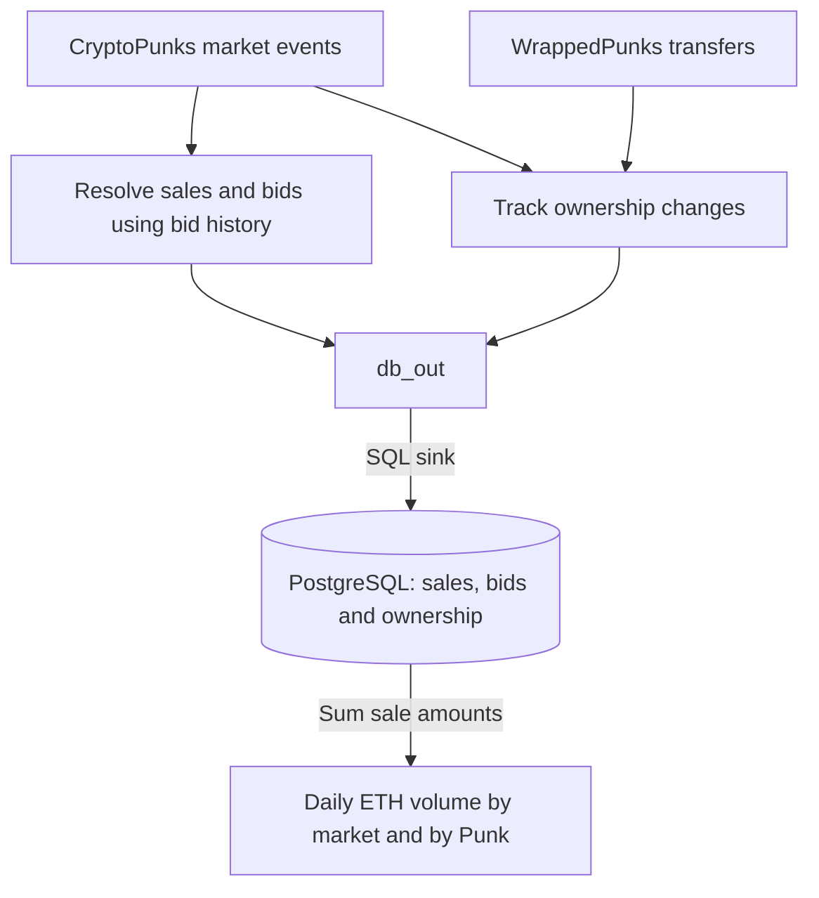

# CryptoPunks Market Indexer

A Rust and Substreams indexer that reconstructs CryptoPunks sales, bids, and ownership from Ethereum logs and writes them to PostgreSQL.

Punk #544 sold for **0.01 ETH**. Its sale event recorded zero for both price and buyer. The indexer recovers the buyer from the preceding transfer and the price from the active bid. [Sale logs](https://etherscan.io/tx/0xb28b5f2c186bf534e4fc4b8604b1496c9632e42269424f70ef1bdce61ea8ba52#eventlog) · [Earlier bid](https://etherscan.io/tx/0x58c517987e4246452c452c9992379212fe69c23e6d33134f7ddfba87ae82ff8f)

```sql
SELECT token_id, trim_scale(amount_eth) AS eth,
       CASE WHEN bid_accepted THEN 'True' ELSE 'False' END AS bid_accepted
FROM sales
WHERE token_id = 544 AND block_number = 3919706;
-- 544 | 0.01 | True
```

## PostgreSQL dataflow



## Try it

- **Saved receipt** — `cargo test --locked mainnet_same_block` replays Punk #4936’s bid increase. Requires Rust 1.90 and `protoc`.
- **Live sale** — With Substreams CLI 1.23.0, run `substreams auth` once, then `make stream` to see Punk #4662’s 3.1 ETH sale.

[PostgreSQL walkthrough](docs/SQL_GUIDE.md) · [Module reference](docs/REFERENCE.md) · [100,000-block validation](docs/VALIDATION.md)
